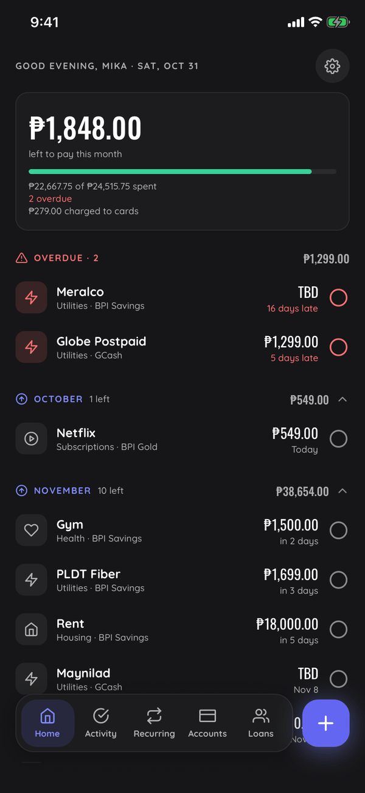
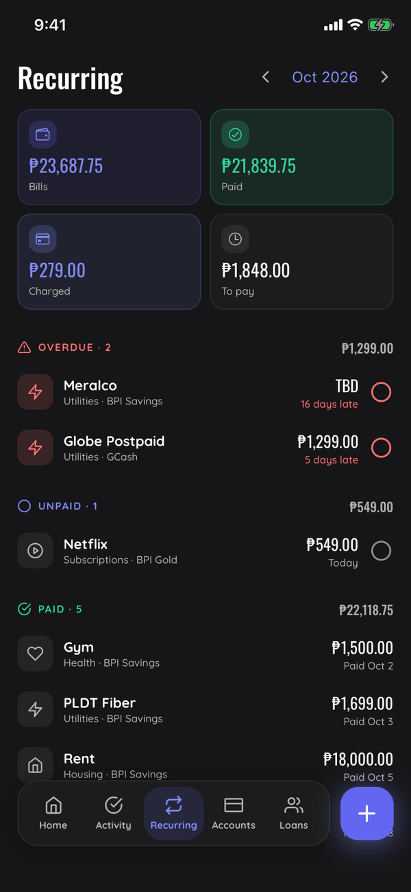
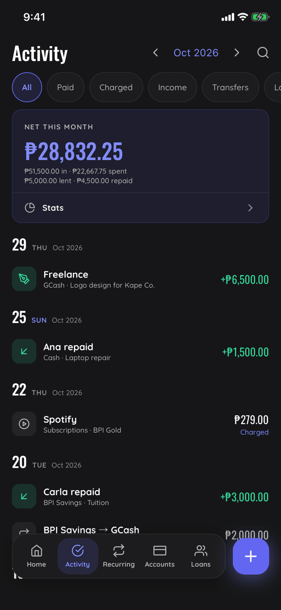
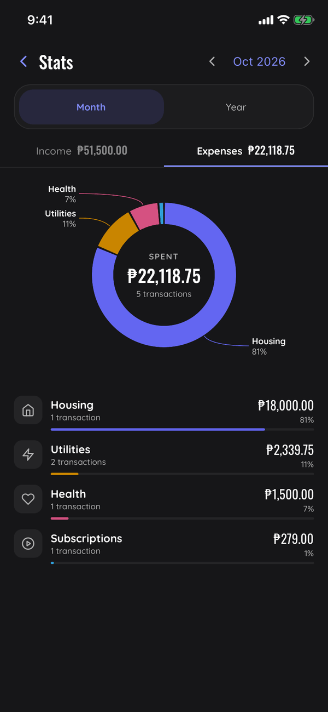
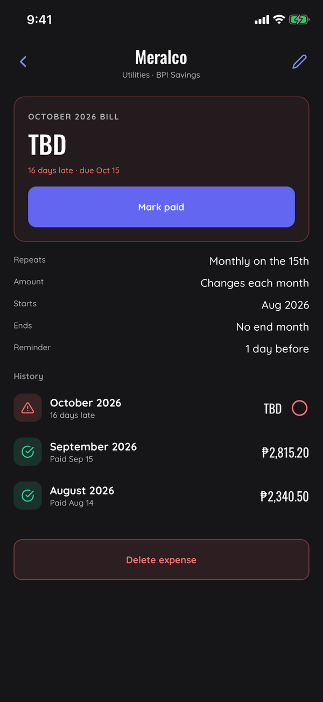
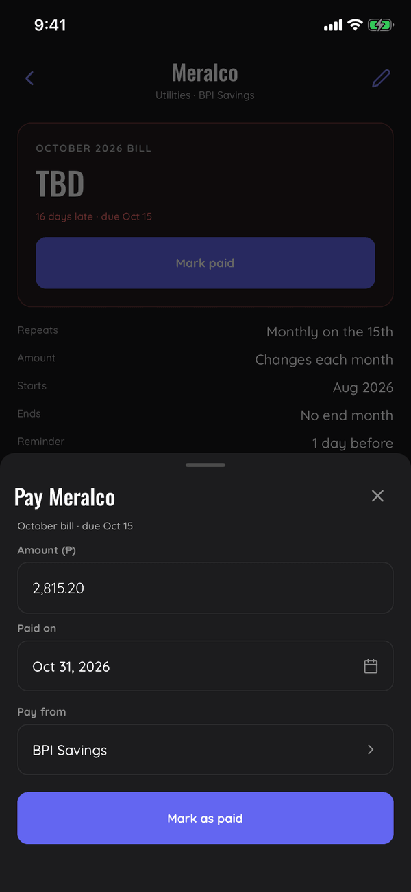
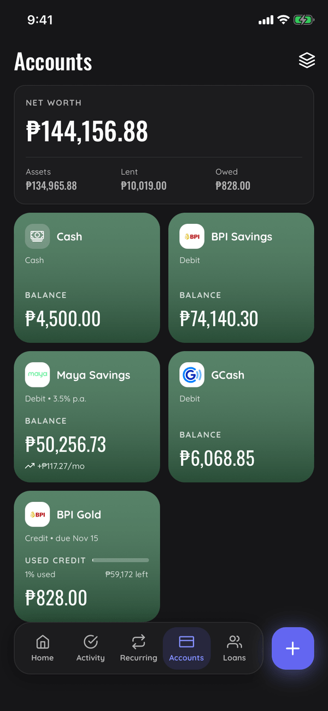
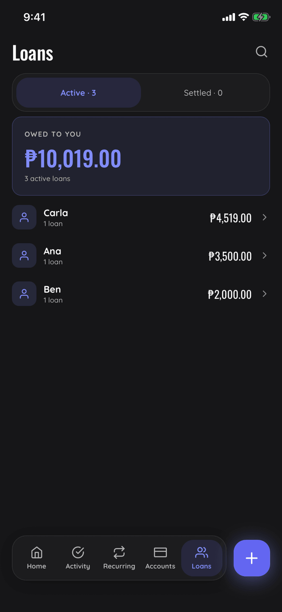

<h1 align="center">Recur</h1>

<p align="center">
  <strong>See what's due, pay it in a tap, and know where your money went.</strong>
</p>

<p align="center">
  Bills, accounts, cards and loans in one app for iPhone and Android.<br />
  Made for the Philippines · Works offline · No account needed
</p>

<p align="center">
  &nbsp;
  &nbsp;
  &nbsp;
  
</p>

Recur keeps your recurring bills in one place, together with the bank accounts, e-wallets and credit cards you pay
them from and the money you've lent out. Open it to see what's left to pay this month, what's late and what's next.
Amounts are in Philippine pesos (₱).

## Why Recur

- **Nothing slips.** Home shows what's left to pay this month, what's late and what's due next, and a reminder
  arrives before each bill.
- **Paying takes a tap.** Tap the circle or swipe the row, and undo it if you got it wrong.
- **History stays true.** Each payment keeps what it cost, when you paid and which account it came from. Editing a
  bill later never rewrites the past.
- **Your data stays on your phone.** No sign-up, no servers, no ads, no tracking.

## Features

### Bills

- Monthly, yearly and one-off bills, each due on a day of the month. A bill due on the 31st falls on the last day of
  shorter months.
- Bills that change every month, like electricity or water, show **TBD** until you pay them. You enter the actual
  amount then.
- Give a bill a start and end month, so an installment plan or a cancelled subscription stops on its own.
- Late bills turn red and stay on Home for up to 3 months until you pay them. Recur never marks anything paid for you.
- Every bill has its own page with this month's status and each past payment.

### Paying

- A bill with a set amount is paid in one tap, from the account you picked for it.
- For a TBD bill, the Pay sheet asks for the amount, the date you paid and the account it came from.
- Every payment shows an **Undo** right after, in case you tapped the wrong one.

<p align="center">
  &nbsp;
  
</p>

### Home and Recurring

- Home leads with what you've **spent this month** and what came in, then how much went on cards and what you're owed.
- Below that: overdue bills, this month, next month, credit card bills and money owed to you.
- The Recurring tab steps through any month: total bills, paid, charged to cards and still to pay.

### Activity and Stats

- Every payment, card charge, income, transfer and loan in one feed, by day, with filters and search.
- **Net this month** shows money in, spent, lent and repaid.
- Stats breaks spending and income down by category, for a month or a whole year.

### Accounts and cards

- Bank accounts, e-wallets, credit cards and cash, with logos for 14 Philippine banks and e-wallets, including BDO,
  BPI, GCash and Maya.
- **Net worth** across everything you have, lend and owe.
- Credit cards keep their limit, statement day and due date, and each month's card bill joins your other dues.
- Savings interest is credited automatically at your account's rate, minus withholding tax.
- Move money between accounts, with transfer fees, and edit or backdate a transfer later.
- Bank and cash balances never go below ₱0. If a payment would overdraw an account, Recur offers a transfer to cover
  it.
- Archive an account you've closed. Its history stays.

### Loans

- Track money you lend: to whom, how much, from which account, and at what interest (none, a fixed amount, a one-time
  %, or a monthly % of the original or remaining balance).
- Log repayments as they come in and see what's still owed.
- Lending isn't spending: loans stay out of your expense and income totals and still count toward your net worth.

<p align="center">
  &nbsp;
  
</p>

### Reminders

- A notification before each bill (1, 2 or 3 days, or a week ahead, or off) at the time of day you choose.
- Reminders name the bill. When a single bill is due, the reminder has a **Mark paid** button that opens it ready to
  pay.

### Categories

- Start with Housing, Utilities, Subscriptions, Insurance, Transport, Food, Health and Other, and add your own for
  expenses and income.
- Rename a category and every bill and income that uses it follows.

### Backups

- Export everything to one file and keep it wherever you like. Home reminds you when it's been a month since your
  last backup.
- Importing a backup adds what's missing and never overwrites what you already have.

## Private by design

Recur keeps everything in a database on your phone. There's no sign-up, no server, no analytics and no ads, and it
works fully offline. Your data only leaves the phone when you export a backup.

## Get Recur

Recur isn't on the App Store or Google Play. To install it, build it yourself. With Node.js and Android Studio set
up, connect your phone (with USB debugging on) or start an emulator, then run:

```bash
npm install
npx expo run:android --variant release
```

That installs a standalone build that works without a computer attached. iPhone builds need Xcode and an Apple
Developer account; see the developer notes below.

<details>
<summary><strong>Developer notes</strong></summary>

<br />

Recur is an Expo (React Native) app in TypeScript, styled with NativeWind, with its data in SQLite on the device.
Code conventions live in [`CLAUDE.md`](CLAUDE.md) and the visual language in [`DESIGN.md`](DESIGN.md).

#### Run a debug build

```bash
npm install
npm start          # Expo dev server
npm run ios        # iOS simulator
npm run android    # Android emulator
```

#### Several checkouts on Android

```bash
npm run start:wt                       # this checkout's Metro, on this checkout's own emulator
npm run start:wt -- -s R5CT30ABCDE     # on another device instead (a phone, or any emulator serial)
adb -s $(npm run -s start:wt -- --print-serial) logcat   # adb on this checkout's emulator
npm run start:wt -- --prune            # delete the emulators of checkouts that are gone
```

Each checkout runs Metro on its own port and owns one emulator, `recur_wt_<checkout>`. The first run clones it
from your first AVD (or `AVD=<name>`), app and data included, so later runs only boot or reuse it, and other
checkouts' emulators are left alone.

#### iOS Simulator

Needs Xcode (with an iOS simulator runtime) and CocoaPods.

```bash
brew install cocoapods                # once
npx expo run:ios -d "iPhone 17 Pro"   # once, and after native changes: builds + installs the debug app (ios/ is generated, not committed)
npm run start:wt -- --ios             # this checkout's Metro, with the simulator pointed at it
```

The iOS app's prebuilt React Native always looks for Metro on :8081, so with several checkouts running it can
load another one's code. `start:wt -- --ios` sets the simulator's bundler location to this checkout's port.

#### Builds

```bash
npm run build:apk      # Android APK (EAS preview)
npm run build:aab      # Android AAB (EAS production)
npm run build:ios-sim  # iOS Simulator build (EAS, no Apple account needed)
npm run build:ipa      # iPhone build for registered devices (EAS preview, needs an Apple Developer account)
```

Requires EAS CLI and an Expo account for cloud builds. Pushing to `master` builds the APK and the iOS Simulator
build (`.eas/workflows/build.yml`). Install the latest simulator build with `npx eas-cli build:run -p ios --latest`.

To get installable iPhone builds: join the Apple Developer Program, run `npm run build:ipa` once to sign in and
let EAS create the certificate and profile, register each iPhone with `npx eas-cli device:create`, then switch
`build_ios` in `.eas/workflows/build.yml` to the `preview` profile.

#### App size

Android release builds ship `arm64-v8a` and `armeabi-v7a` only, run R8 and resource shrinking, and leave out
Fresco's GIF/WebP decoders (`app.json`, `plugins/`). Don't turn on Expo's experimental Metro tree shaking
(`EXPO_UNSTABLE_TREE_SHAKING`): it drops NativeWind's `global.css` import and the app renders unstyled.

Generated assets, committed alongside their sources:

```bash
node scripts/subset-fonts.mjs        # Oswald without Cyrillic/Greek + the Ionicons in constants/ionicons.ts
node scripts/generate-bank-logos.mjs # assets/banks/*.svg → @1x/@2x/@3x PNGs
```

</details>
